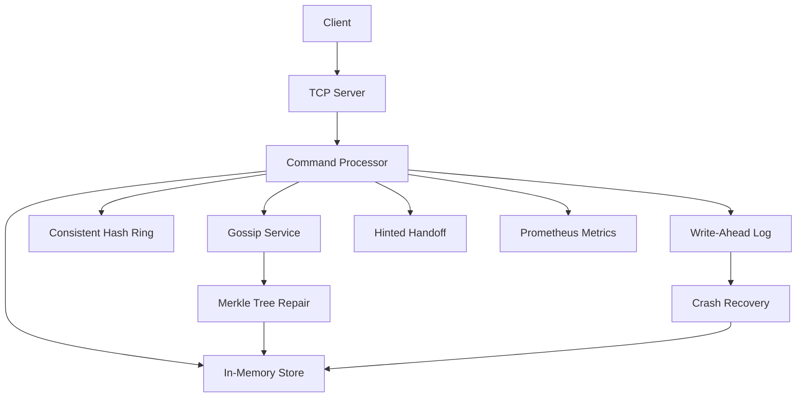
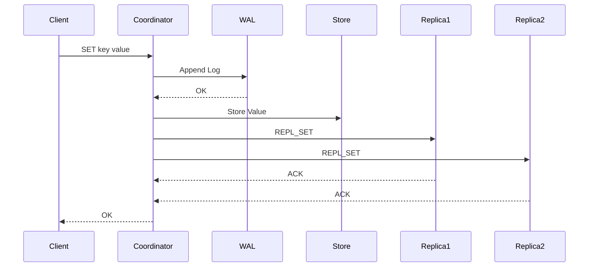
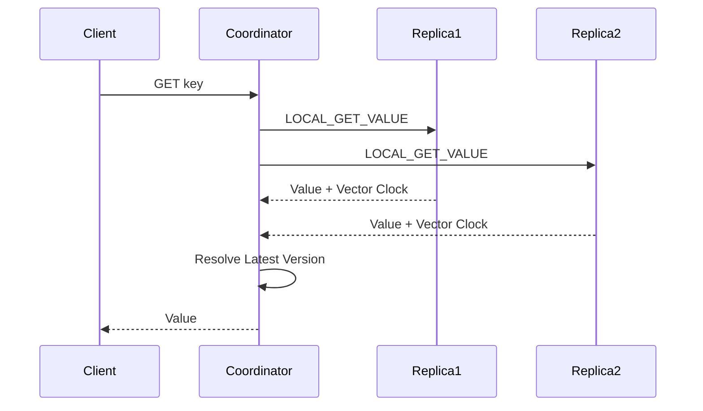

# MiniKV

> A distributed, fault-tolerant key-value store built in Go, implementing core distributed systems concepts such as consistent hashing, replication, write-ahead logging, vector clocks, Merkle trees, gossip-based failure detection, and hinted handoff.

MiniKV is an educational distributed database inspired by the architecture of modern distributed storage systems such as Amazon Dynamo. The project was built to explore how distributed key-value stores achieve scalability, fault tolerance, data consistency, and high availability while remaining simple enough to understand from first principles.

Unlike a traditional in-memory key-value store, MiniKV supports multi-node clusters, automatic data partitioning, replication, crash recovery, anti-entropy synchronization, and quorum-based reads and writes. The implementation emphasizes clean architecture, modular design, and testability, making it both a learning resource and a practical reference for distributed systems concepts.

## Table of Contents

- [Why MiniKV?](#why-minikv)
- [Features](#features)
- [Architecture](#architecture)
- [Write Request Flow](#write-request-flow)
- [Read Request Flow](#read-request-flow)
- [Quick Start](#quick-start)
- [Performance](#performance)
- [Project Structure](#project-structure)
- [Roadmap](#roadmap)
- [License](#license)

---

## Why MiniKV?

Distributed databases rely on several algorithms and protocols working together to provide reliability and availability. Instead of treating these concepts independently, MiniKV integrates them into a single project to demonstrate how they interact in a real system.

The project implements many of the building blocks found in production-grade distributed databases, including:

- Consistent Hashing with Virtual Nodes
- Replication with Configurable Read/Write Quorums
- Write-Ahead Logging (WAL)
- Crash Recovery
- Vector Clocks for Versioning
- Merkle Trees for Anti-Entropy Synchronization
- Gossip-based Failure Detection
- Hinted Handoff (in-memory queue; not yet restart-durable)
- Connection Pooling
- Prometheus Metrics
- Unit and Integration Testing

## Features

| Feature                                    | Description                                                                                              |
| ------------------------------------------ | -------------------------------------------------------------------------------------------------------- |
| **Concurrent In-Memory Storage**     | Thread-safe key-value storage using Go's `sync.RWMutex` for concurrent reads and writes.               |
| **TCP-Based Client/Server Protocol** | Lightweight text-based protocol supporting `SET`, `GET`, `DEL`, and internal replication commands. |
| **Write-Ahead Logging (WAL)**        | Persists write operations before applying them to memory, ensuring durability and crash recovery.        |
| **Crash Recovery**                   | Automatically rebuilds the in-memory state by replaying WAL logs during startup.                         |
| **Consistent Hashing**               | Evenly distributes keys across cluster nodes while minimizing data movement when nodes join or leave.    |
| **Virtual Nodes**                    | Improves load balancing by assigning multiple virtual nodes to each physical node.                       |
| **Replication**                      | Replicates data across multiple nodes to improve fault tolerance and availability.                       |
| **Read/Write Quorums**               | Ensures configurable consistency guarantees using quorum-based operations.                               |
| **Vector Clocks**                    | Tracks object versions and detects concurrent updates without relying solely on timestamps.              |
| **Merkle Trees**                     | Performs anti-entropy synchronization by efficiently detecting replica inconsistencies.                  |
| **Gossip-Based Failure Detection**   | Periodically exchanges node health information to detect failures in the cluster.                        |
| **Hinted Handoff**                   | Stores temporary hints for unavailable replicas and replays them when the node recovers.                 |
| **Connection Pooling**               | Reuses TCP connections between nodes to reduce connection overhead during replication.                   |
| **Prometheus Metrics**               | Exposes operational metrics for monitoring request counts, latency, replication, and cluster health.     |
| **Unit & Integration Tests**         | Includes comprehensive unit tests for core components and integration tests for distributed behavior.    |

## Architecture

MiniKV follows a modular architecture where each component is responsible for a specific part of the distributed system.



The command processor acts as the coordinator of the system. Every client request is routed through the protocol layer, which determines ownership using the consistent hash ring, persists writes through the WAL, coordinates replication, and serves read/write requests. Supporting components such as gossip, hinted handoff, Merkle trees, and crash recovery work together to maintain consistency and fault tolerance across the cluster.

## Write Request Flow



## Read Request Flow



## Quick Start

### Prerequisites

- Go 1.26.3 (the version declared in go.mod)
- Git

### Clone the repository

```bash
git clone https://github.com/Choudhary-Sahil099/MiniKV.git
cd MiniKV
```

### Install dependencies

```bash
go mod download
```

### Start a Three-Node Cluster

Open three separate terminals.

#### Terminal 1

```bash
go run ./cmd/server NodeA 5000
```

#### Terminal 2

```bash
go run ./cmd/server NodeB 5001
```

#### Terminal 3

```bash
go run ./cmd/server NodeC 5002
```

Each server automatically:

- Loads the latest snapshot (if available)
- Replays the Write-Ahead Log (WAL)
- Joins the consistent hash ring
- Starts gossip-based heartbeat monitoring
- Starts anti-entropy synchronization
- Enables hinted handoff replay
- Exposes Prometheus metrics

### Start the Client

Open another terminal.

```bash
go run ./cmd/client
```

You can now execute commands such as:

```text
SET name Sahil
GET name
DEL name
```

## Performance

MiniKV includes a concurrent load-testing tool to evaluate write throughput under a replicated three-node cluster.

### Benchmark Configuration

| Configuration      | Value   |
| ------------------ | ------- |
| Cluster Size       | 3 Nodes |
| Replication Factor | 3       |
| Total Requests     | 10,000  |
| Concurrent Clients | 100     |
| Operation          | SET     |
| Transport          | TCP     |

### Recorded measurements and current target

An earlier repository benchmark recorded approximately 1,650 SET requests/sec for 10,000 requests with 100 concurrent clients. A more recent three-node cluster run was reported during development at approximately 12,000 requests/sec, with a target of 16,000 requests/sec. The recent run's exact workload, hardware, durability settings, and raw output have not yet been captured in this repository, so the two measurements must not be treated as directly comparable.

Before claiming the 16,000 requests/sec target, run the benchmark against all three nodes and record: operation mix, total requests, concurrency, client connections, successful and failed operations, replication factor, read/write quorum, WAL segment size, host CPU/RAM/disk, duration, throughput, and p50/p95/p99 latency. An acknowledged write must remain WAL-synced and meet the configured write quorum.

Run a repeatable three-node SET workload from the repository root (after all three nodes are listening):

```powershell
go run ./benchmarks -requests 50000 -concurrency 200 -addresses 127.0.0.1:5000,127.0.0.1:5001,127.0.0.1:5002
```

The harness distributes persistent client connections across the supplied addresses and reports successful/failed writes plus p50/p95/p99 latency. It is SET-only; use a separate explicitly described workload for GET or mixed traffic.

## Project Structure

```text
MiniKV
├── benchmarks/          # Load testing utilities
├── cmd/
│   ├── client/          # Interactive CLI client
│   └── server/          # MiniKV server entry point
├── config/              # Cluster configuration and validation
├── internal/
│   ├── client/          # Connection pooling & networking
│   ├── cluster/         # Cluster membership
│   ├── config/          # Runtime configuration
│   ├── gossip/          # Gossip protocol & failure detection
│   ├── handoff/         # Hinted handoff
│   ├── hashring/        # Consistent hashing
│   ├── merkle/          # Merkle tree anti-entropy
│   ├── metrics/         # Prometheus metrics
│   ├── network/         # TCP server, protocol dispatch, command handlers
│   ├── repair/          # Anti-entropy synchronization
│   ├── storage/         # Thread-safe key-value storage
│   ├── vectorclock/     # Versioning
│   └── wal/             # Write-ahead logging
├── integration/         # Multi-node integration and recovery tests
├── deploy/              # Prometheus, Grafana, and Caddy configuration
├── scripts/             # Operational scripts
├── go.mod
├── README.md
└── AUDIT_REPORT.md
```

## Roadmap

### Implemented capabilities

- [X] Concurrent in-memory storage
- [X] TCP client/server protocol
- [X] Write-ahead logging and segment rotation
- [X] Snapshot loading/saving and WAL replay
- [X] Consistent hashing and virtual nodes
- [X] Replication with read/write quorum checks
- [X] Vector-clock version metadata and tombstones
- [X] Merkle-tree anti-entropy
- [X] Heartbeat-based failure detection
- [X] Hinted handoff (currently memory-only)
- [X] Peer connection pooling
- [X] Prometheus metrics and Grafana dashboard provisioning
- [X] Docker Compose single-host demonstration stack
- [X] Unit and multi-node integration tests

These capabilities have varying levels of hardening. See [AUDIT_REPORT.md](AUDIT_REPORT.md) for verified fixes, validation limits, and remaining release blockers.

### Next engineering priorities

- [ ] Durable hinted-handoff queue
- [ ] Snapshot/WAL checkpoint protocol and safe segment retention
- [ ] Tombstone garbage collection using a cluster-wide safe watermark
- [ ] Authentication, authorization and TLS for the client protocol
- [ ] Explicit handling/preservation of concurrent vector-clock versions
- [ ] Multi-host deployment across independent failure domains
- [ ] Dynamic membership and safe data rebalancing
- [ ] Reproducible 16,000 successful requests/sec benchmark with latency/resource reporting

## Acknowledgements

MiniKV was inspired by the concepts presented in:

- Amazon Dynamo: *Dynamo: Amazon's Highly Available Key-value Store* (DeCandia et al., SOSP 2007)
- Google File System (GFS)
- Apache Cassandra
- Riak KV

The project was built as an educational implementation to better understand the core algorithms behind modern distributed databases.

## License

No license file was included in the supplied repository archive. Choose and add the intended license before redistributing the project.
